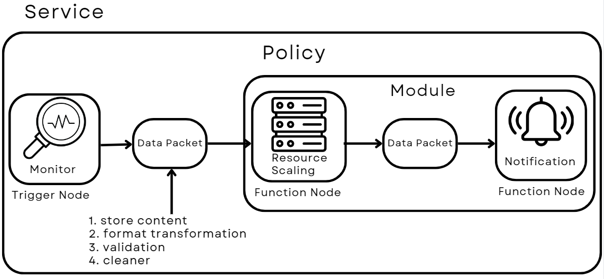

# LCM

## APIs to test LCM

- Service
  - GET     /api/service/:service_Name
    - get the information of a service
    - `curl -X GET "localhost:8000/api/service/service-1"`
  - POST    /api/service
    - register a service with post json body
    - `curl -X POST -H "Content-Type: application/json" -d '{"service_name":"service-1","module":[],"policy":[{"name":"policy-1","type":"default","trigger":[{"name":"interval-0","type":"Interval","property":{"Interval":1}}],"node":[],"path":[]}]}' localhost:8000/api/service`
  - PUT     /api/service
    - reconfigure a service with put json body
    - `curl -X PUT -H "Content-Type: application/json" -d '{"service_name":"service-1","module":[],"policy":[{"name":"policy-1","type":"default","trigger":[{"name":"interval-0","type":"Interval","property":{"Interval":2}}],"node":[],"path":[]}]}' localhost:8000/api/service`
  - POST    /api/service/file
    - register a service with a configuration file
    - `curl -X POST -F "config=@config.yaml" localhost:8000/api/service/file`
  - PUT     /api/service/file
    - reconfigure a service with a new configuration file
    - `curl -X PUT -F "config=@reconfig.yaml" localhost:8000/api/service/file`
  - DELETE  /api/service/:service_Name
    - delete a service
    - `curl -X DELETE "localhost:8000/api/service/service-1"`

- Policy
  - GET /api/service/:service_Name/policy/:policy_Name
    - get the information of a policy
    - `curl -X GET "localhost:8000/api/service/service-1/policy/policy-1"`
  - POST /api/service/policy/deploy
    - deploy/undeploy a service's policies
    - `curl -X POST -H "Content-Type: application/json" -d '{"SvcName":"service-1", "Type": "POLICY_DEPLOY", "Policies": ["policy-1"]}' localhost:8000/api/service/policy/deploy`
    - `curl -X POST -H "Content-Type: application/json" -d '{"SvcName":"service-1", "Type": "POLICY_UNDEPLOY", "Policies": ["policy-1"]}' localhost:8000/api/service/policy/deploy`

- DataPacket
  - GET  /api/service/:service_Name/policy/:policy_Name/datapacket
    - get the information of a node's data packet
    - `curl -X GET "localhost:8000/api/service/service-1/policy/policy-1/datapacket?node=p1-if-0&port=0"`
  - POST /api/service/:service_Name/policy/:policy_Name/datapacket
    - set the transformat of a node's data packet
    - `curl -X POST -H "Content-Type: application/json" -d '{"NodeName":"p1-if-0", "Port": 0, "TransFormat": [{"src": "a", "dst": "b"}]}' localhost:8000/api/service/service-1/policy/policy-1/datapacket`

- Misc
  - POST /api/webhook
    - send the webhook event to each deployed policies
    - `curl -X POST -H "Content-Type: application/json" -d '{"SvcName":"service-1", "EventType": "default", "Content": {"Value": 10}}' localhost:8000/api/webhook`