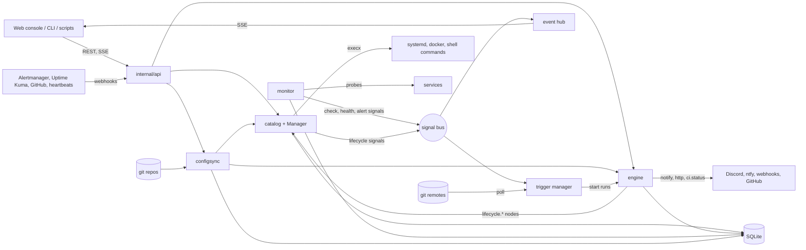

# Architecture

LCM is one Go process (`lcm serve`) with one SQLite database. The HTTP API, the web console, the policy engine, the service catalog, the health monitor and the trigger watchers all run inside it. Setup and configuration are in the [README](../README.md); operating it is in [operations.md](operations.md).

## Components and data flow



A typical loop: a health check fails, `monitor` publishes a `health.changed` signal, `trigger.signal` starts a run of a deployed policy, the policy's `lifecycle.restart` node asks the `Manager` for the action, the manager takes the service lock, moves the lifecycle state, runs the runtime command through `execx` and writes the timeline and audit entries. Every step is visible in the event stream.

| Component | Responsibility |
|---|---|
| `internal/app` | Builds all components in dependency order, runs the background loops, shuts down in reverse. The only place that connects components. |
| `internal/store` | SQLite with one writer connection and a reader pool; numbered migrations applied at startup. |
| `internal/engine` | Compiles policies into plans and runs them; checkpoints every node so runs survive restarts. |
| `internal/catalog` | Service documents and versions, the lifecycle state machine, deployments, timeline; the `Manager` performs actions under a durable lock. |
| `internal/monitor` | Health checks, history, rollups, health aggregation and alert ingestion. |
| `internal/trigger` | `trigger.*` nodes and the watchers behind them (signals, git polling, cron, webhooks). |
| `internal/configsync` | Policy-as-code: applies documents from files or git, tracks ownership, drift and conflicts. |
| `internal/templates` | Built-in policy templates (`examples/templates`). |

## Engine semantics

The rules (compile checks, dead-path elimination, join modes, retries, suspend and resume, recovery, concurrency modes) are written down in [`internal/engine/doc.go`](../internal/engine/doc.go), which is the authority. In short:

- A policy is a graph of nodes started by one trigger node. Props are expressions over `trigger`, `nodes`, `params`, `run`, `state` and `service`.
- Nodes pick an output port; the edges of other ports are dead, and dead paths resolve without running. A node waits for all live inbound edges (`joinMode: all`) or the first (`any`).
- Waiting (`wait.until`, `flow.wait`, CI polling) parks the node on a timer without holding a worker; parked runs survive restarts.
- Write nodes record a running row before they act and carry an idempotency key, so a node interrupted by a crash does not act twice; interrupted runs resume or abort according to `onInterrupt`.
- Concurrency per policy is `queue`, `drop`, `replace` or `parallel`.

The `service` variable exposes `{ state, health, checks.<name>.{status, critical, lastResultMs} }` per service, so a policy can wait for health without probing the service itself. Templates compare `lastResultMs` with the end of the deployment so a stale "healthy" is never mistaken for recovery.

## Security model

LCM restarts services and runs commands, so it is a high-privilege system. The design keeps that power narrow and visible.

**Process and listener.** It listens on `127.0.0.1` by default and warns otherwise. It speaks plain HTTP; put a TLS proxy in front for remote access and set `LCM_COOKIE_SECURE=true`. Cross-origin browser requests are refused.

**Execution permissions.** LCM runs as an unprivileged user. Anything it executes (service `build`, `install`, `backup` and `jobs` commands, command runtimes, command health checks) runs as that user through `execx`, with a short environment allowlist (`PATH`, `HOME`, `XDG_RUNTIME_DIR` and a few more) so LCM's own variables never reach children. Whoever can write a Service document (an admin session or token, or a config-sync repository) can therefore make LCM run commands as that user: treat write access to those documents like shell access to the LCM user.

System-scope systemd units are controlled with a configured prefix, `sudo -n` by default (`LCM_SYSTEMCTL_PRIVILEGE`). A sudoers rule limits it to start, stop and restart of the units LCM may touch; status queries need no privilege. User-scope units (`scope: user`) use `systemctl --user` and need nothing. Example `/etc/sudoers.d/lcm`:

```
Cmnd_Alias LCM_UNITS = \
    /usr/bin/systemctl start myapp.service, /usr/bin/systemctl stop myapp.service, /usr/bin/systemctl restart myapp.service, \
    /usr/bin/systemctl start worker.service, /usr/bin/systemctl stop worker.service, /usr/bin/systemctl restart worker.service
lcm ALL=(root) NOPASSWD: LCM_UNITS
```

Because the rule lives on the host, a document cannot widen it: allowlists, the privilege prefix and the reachable units are host configuration and are never read from a document. Do not set `NoNewPrivileges=yes` on LCM's own unit; it would disable `sudo`.

**Authentication and token scopes.** The admin account is created from the CLI only (`lcm admin set-password`, passwords are hashed with argon2id). Browsers use a session cookie; scripts use bearer tokens. Tokens have a scope: `admin` reaches the whole API except token management, `ingest` reaches only alert, heartbeat and webhook endpoints and `GET /auth/me`. Creating and revoking tokens needs a session, so a leaked token can never mint more tokens. Webhook listeners with an `hmacSecret` and the GitHub endpoint (with `LCM_GITHUB_WEBHOOK_SECRET`) accept a valid HMAC signature instead of a token. Failed logins are rate limited.

**Secrets.** Secrets are files, one per secret, in `LCM_SECRETS_DIR` (mode 0600; a looser mode is refused), with environment variables `LCM_SECRET_<NAME>` as a fallback. Documents and policies refer to a secret by name (`urlSecret`, `tokenSecret`, ...); the value is read when a node runs and is kept out of logs, audit details, run traces and API responses.

**Audit.** Every state-changing action writes an audit entry with the actor (user, token, system or policy run). CLI commands that open the database directly are recorded as `system` / `cli`.

**Config ownership.** Resources applied from a git config source belong to that source. Edits in the web console take effect at once and mark the resource drifted; a new commit never overwrites a drifted resource and never deletes anything (conflicts and orphans are reported). Git runs only through `execx` with a fixed environment, in LCM's own clones under the data directory.
