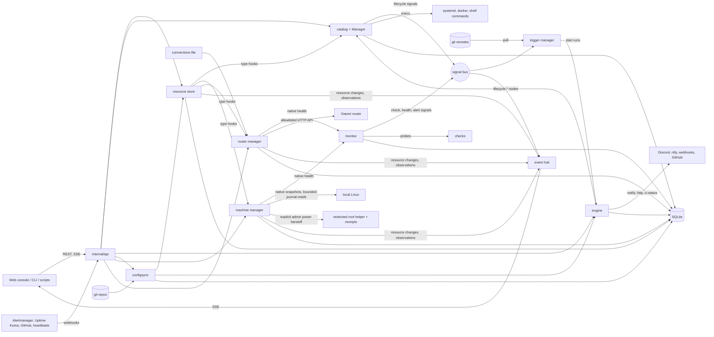

# Architecture

LCM is one Go process (`lcm serve`) with one SQLite database. The HTTP API, the web console, the policy engine, the resource registry, the service catalog, the health monitor, the machine and router managers and the trigger watchers all run inside it. Setup and configuration are in the [README](../README.md), the shared resource model in [resources.md](resources.md), type behavior in [services.md](services.md) and [machines.md](machines.md), policies in [policies.md](policies.md), and running it on a host in [operations.md](operations.md).

## Components and data flow



A typical loop: a health check fails, `monitor` publishes a `health.changed` signal, `trigger.signal` starts a run of a deployed policy, the policy's `lifecycle.restart` node asks the `Manager` for the action, the manager takes the resource lock, moves the lifecycle state, runs the runtime command through `execx` and writes the timeline and audit entries. Every step is visible in the event stream.

| Component | Responsibility |
|---|---|
| `internal/app` | Builds all components in dependency order, registers the resource types, loads connections, recovers machine/router operations and gates, runs observation, triggers, monitor/config sync, retention and reconciliation, and shuts down in reverse. The only place that connects components. |
| `internal/api` | HTTP handlers, middleware, error envelope and the OpenAPI document; handlers parse, call a component and map errors. |
| `internal/store` | SQLite with one writer connection and a reader pool; numbered migrations applied at startup (0014 converts Service/Machine data to resources in Go and SQL), with rejection of a newer schema. |
| `internal/engine` | Compiles policies into plans and runs them; checkpoints every node so runs survive restarts. |
| `internal/resource` | Resource registry for every type: immutable IDs, versioned `lcm/v2` documents, phases, archives, relations, impact and the type facade (`Type`, `TypeHooks`) the other components implement ([resources](resources.md)). |
| `internal/catalog` | The service type: lifecycle state machine, deployments, timeline, group actions; the `Manager` performs actions under a durable lock and reconciles states with the runtimes ([services](services.md#lifecycle-states-and-actions)). |
| `internal/runtime` | Adapters that control processes (systemd, docker, compose, command, external) and declare which actions each configuration supports. |
| `internal/security` | Bounded incident/traffic storage, operator handling, versioned notification preferences and durable Konata outbox. |
| `internal/securityhost` | Typed preview/apply/query client for the independent root security helper; durable operator intent without generic privilege. |
| `internal/monitor` | Health checks, history, rollups, health aggregation and alert ingestion. |
| `internal/machine` | The machine type: snapshots, native health, journal checkpoints, history, maintenance and durable power operations; `observe/` provides bounded read-only probes, `power/` the restricted root helper protocol and independent receipt store. |
| `internal/router` | The router type: per-router observation loops, native health and durable reboot operations; `xiaomi/` is the allowlisted client of the router's web API ([routers](resources.md#routers)). |
| `internal/connection` | Loads and validates the host connections file; documents name connections but cannot widen them. |
| `internal/maintenance` | Durable local machine maintenance gate shared by resource writes, service actions, router reboots, config sync and self-deploy; observations continue. |
| `internal/trigger` | `trigger.*` nodes and the watchers behind them (signals, git polling, cron, webhooks). |
| `internal/configsync` | Policy-as-code: applies documents from files or git, tracks ownership, drift and conflicts. |
| `internal/events` | Event hub behind the SSE stream: bounded, filtered subscriptions fed by the signal bus, engine observers, resource changes and machine/router observations. |
| `internal/templates` | Built-in policy templates (`examples/templates`). |

Every type shares one registry and write path; type-specific work runs in the type's hooks inside the store's write transaction, so there is never a second copy of a resource that could overwrite the first. The monitor combines checks with the native health machines and routers report. Observations, health baselines, journal events and cursors commit together before best-effort SSE publication as `observation` events keyed by immutable ID. A data-directory file lock permits only one `serve` process; startup recovers machine and router operations and maintenance gates before enabling writes and automation. The shared Gate and durable maintenance row protect local writes; this is a single-controller design, not a distributed lease or HA protocol. The [Machine contract](machines.md) owns identity, freshness, retention and completion semantics.

## Engine semantics

The rules (compile checks, dead-path elimination, join modes, retries, suspend and resume, recovery, concurrency modes) are written down in [`internal/engine/doc.go`](../internal/engine/doc.go), which is the authority. In short:

- A policy is a graph of nodes started by one trigger node. Props are expressions over `trigger`, `nodes`, `params`, `run`, `state` and `resource`.
- Nodes pick an output port; the edges of other ports are dead, and dead paths resolve without running. A node waits for all live inbound edges (`joinMode: all`) or the first (`any`).
- Waiting (`wait.until`, `flow.wait`, CI polling) parks the node on a timer without holding a worker; parked runs survive restarts.
- Write nodes record a running row before they act and carry an idempotency key, so a node interrupted by a crash does not act twice; interrupted runs resume or abort according to `onInterrupt`.
- Concurrency per policy is `queue`, `drop`, `replace` or `parallel`.

The `resource` variable maps each managed and retired resource name to `{ name, type, adapter, phase, state, health, checks.<name>.{status, message, critical, sinceMs, lastResultMs} }`, so a policy can wait for health without probing the resource itself. Templates compare `lastResultMs` with the end of the deployment so a stale "healthy" is never mistaken for recovery.

## Security model

LCM restarts services and runs commands, so it is a high-privilege system. The design keeps that power narrow and visible.

**Process and listener.** It listens on `127.0.0.1` by default and warns otherwise. It speaks plain HTTP; remote access goes through a TLS proxy ([remote access](operations.md#remote-access)). Cross-origin browser requests are refused, and console responses carry a restrictive `Content-Security-Policy` (same-origin scripts; inline styles allowed for CodeMirror and React Flow).

**Execution permissions.** LCM runs as an unprivileged user. Anything it executes (service `build`, `install`, `backup` and `jobs` commands, command runtimes, command health checks) runs as that user through `execx`, with a short environment allowlist (`PATH`, `HOME`, `XDG_RUNTIME_DIR` and a few more) so LCM's own variables never reach children. Whoever can write a service Resource document (an admin session or token, or a config-sync repository) can therefore make LCM run commands as that user: treat write access to those documents like shell access to the LCM user. That includes every sudo rule the user holds (`self-install`, the systemctl rule and, where installed, the machine power and security host helpers): a document command can call a helper directly, without the maintenance confirmation and audit entry the API path records.

System-scope systemd units are controlled with a configured prefix, `sudo -n` by default (`LCM_SYSTEMCTL_PRIVILEGE`). A sudoers rule limits it to start, stop and restart of the units LCM may touch; status queries need no privilege. User-scope units (`scope: user`) use `systemctl --user` and need nothing. Example `/etc/sudoers.d/lcm`:

```
Cmnd_Alias LCM_UNITS = \
    /usr/bin/systemctl start myapp.service, /usr/bin/systemctl stop myapp.service, /usr/bin/systemctl restart myapp.service, \
    /usr/bin/systemctl start worker.service, /usr/bin/systemctl stop worker.service, /usr/bin/systemctl restart worker.service
lcm ALL=(root) NOPASSWD: LCM_UNITS
```

The standard installation grants `self-install` with one fixed argument for [self-deploy](operations.md#self-deploy): it installs the binary built in LCM's own checkout and restarts and verifies LCM from a separate systemd unit. Automatic installation requires equal storage schemas so verification can safely restore the previous binary.

Machine power defaults disabled and requires a [separately authorized helper installation](operations.md#local-machine-power-helper). That additional sudo permission accepts only a fixed no-argument root-owned wrapper running a pinned helper binary, independently of the self-deploy binary. Its permanent receipt ledger survives controller rollback. Direct administrator requests confirmed with a reason and the machine name, maintenance (which the request enters itself) and verified OS/recovery prerequisites are required; no power policy node exists. Receipts prove handoff, not power completion. The [helper source contract](../internal/machine/power/README.md) defines the privileged boundary.

Because the rule lives on the host, a document cannot widen it: allowlists, the privilege prefix and the reachable units are host configuration and are never read from a document.

**Connections.** Network-reached resources (routers) use connections from the host's `LCM_CONNECTIONS_FILE`, which only the host administrator can change: it and every directory above it must be owned by root and not writable by group or others, and it is not a document, not synced from Git and not writable through the API. A document can only name a connection; the connection decides which resources may use it (`allowResources`) and which writes are allowed (`allowActions`); both are allowlists, so an empty list allows nothing. Passwords are secret names resolved at startup and never logged, audited or returned; `GET /connections` returns no address or username. The router client calls a fixed endpoint allowlist that excludes password-returning endpoints ([routers](resources.md#routers)). Router reboots, like machine power, are direct administrator requests only. Do not set `NoNewPrivileges=yes` on LCM's own unit; it would disable `sudo`.

**Authentication and token scopes.** The admin account is created from the CLI only (`lcm admin set-password`, passwords are hashed with argon2id). Browsers use a session cookie; scripts use bearer tokens. Tokens have a scope: `admin` reaches the whole API except token management, `ingest` reaches only alert, heartbeat and webhook endpoints and `GET /auth/me`. Creating and revoking tokens needs a session, so a leaked token can never mint more tokens. Webhook listeners with an `hmacSecret` and the GitHub endpoint (with `LCM_GITHUB_WEBHOOK_SECRET`) accept a valid HMAC signature instead of a token. Failed logins are rate limited per client address; `X-Forwarded-For` counts only from proxies listed in `LCM_TRUSTED_PROXIES` ([remote access](operations.md#remote-access)).

**Secrets.** Secrets are files, one per secret, in `LCM_SECRETS_DIR` (regular files of mode 0600; a looser mode, a symlink or another file type is refused), with environment variables `LCM_SECRET_<NAME>` as a fallback. Documents and policies refer to a secret by name (`urlSecret`, `tokenSecret`, ...); the value is read when a node runs and is kept out of logs, audit details, run traces and API responses.

**Audit.** Every state-changing action writes an audit entry with the actor (user, token, system or policy run). CLI commands that open the database directly are recorded as `system` / `cli`.

**Config ownership.** Documents applied from a git config source belong to that source. Edits in the web console take effect at once and mark the resource drifted; a new commit never overwrites a drifted resource and never deletes anything (conflicts and orphans are reported). Git runs only through `execx` with a fixed environment, in LCM's own clones under the data directory.
